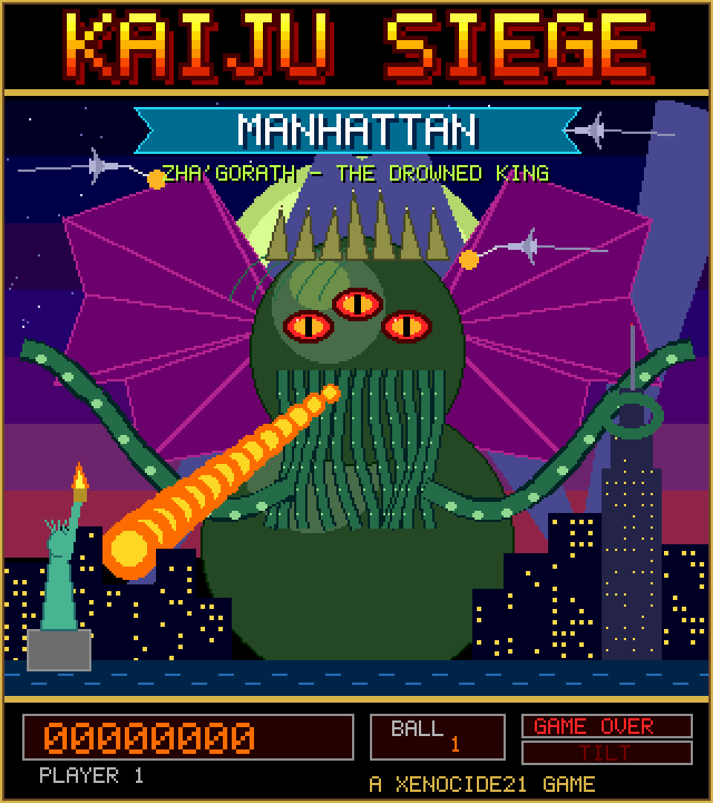
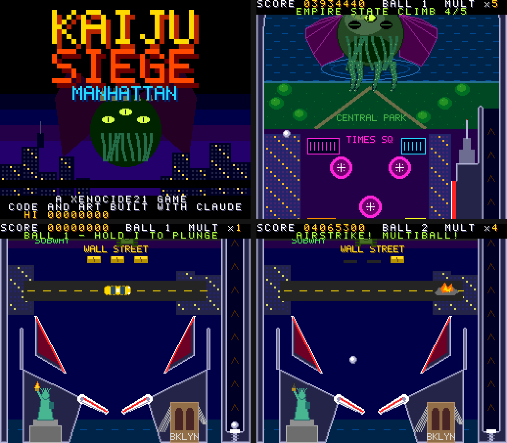
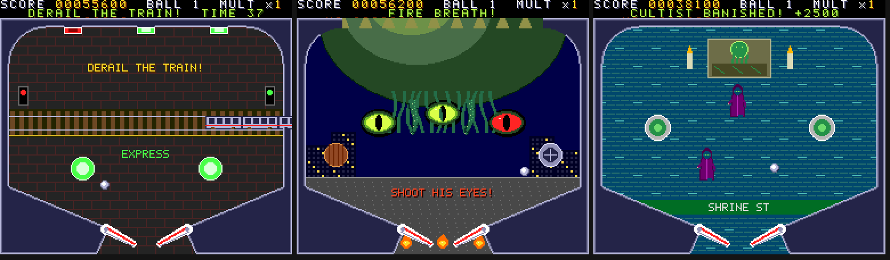

# KAIJU SIEGE: MANHATTAN

TurboGrafx-16 / PC Engine homebrew pinball (HuCard, 256 KB)

A Xenocide21 game. Design and concept by Xenocide21; code and art built with Claude (AI).

**Play it:** download [`rom/kaiju_siege_manhattan.pce`](rom/kaiju_siege_manhattan.pce) and load it in any TurboGrafx-16 / PC Engine emulator.

## Controls
| Button | Action |
|---|---|
| RUN | Start game / pause |
| D-pad (any direction) | Left flipper |
| I or II | Right flipper |
| Hold I (or II / Down) in the plunger lane | Pull the plunger; release to launch (longer hold = harder launch) |
| SELECT | Nudge the table |

## The table
A tall table, about 2.3 screens high, that scrolls with the ball, from the harbor up to the Hudson:

- **Lower Manhattan**: two flippers, slingshots, the **Statue of Liberty** kickback (her torch lit = the left outlane kicks the ball back), the Brooklyn Bridge, a **yellow cab** driving down the street (smash it), and three **Wall Street** gold-bar drop targets. Knock all three down for **MARKET CRASH**: the score multiplier goes up (to x5) and Liberty is relit.
- **Midtown**: three **Times Square** neon pop bumpers, the **army tank** on the avenue (hit it and it fires a shell at the kaiju), the **Subway** hole (Subway Express bonus), and the **Empire State Building** target. Climb all five floors to call in **AIRSTRIKE** (3-ball multiball).
- **Central Park / Hudson**: **ZHA'GORATH, The Drowned King.** Hit his face and sever his four tentacles to open his three eyes. When all three are open he **AWAKENS**: red eyes, pulsing wings, faster tentacles and table-shaking **STOMPs**. Keep hitting him to defeat him (1,000,000 x multiplier). Each time he comes back he's tougher, and the first defeat awards an extra ball.

Once he's awake, Zha'gorath **breathes fire**: three fireballs rain down the table and knock the ball off course.

## Bonus rooms
Each room is a single-screen mini table with its own flippers and a 45-second timer. Draining in a bonus room isn't a lost ball. The ball goes back to the main table.

| Room | How to get in | Goal |
|---|---|---|
| **Subway Tunnel** | Smash the taxi to light the Subway, then sink the ball in the Subway hole | Hit the 3 track switches to **derail the train** (+250,000). Dodge the train as it barrels through |
| **Rooftop Showdown** | Hit the Empire State target once two eyes are open (or he's awake) | Shoot out his 3 giant eyes through fire breath and swinging tentacles. Destroy all three to **slay the kaiju** |
| **The Sunken Shrine** | Every 4th tentacle severed | Smash the altar (6 hits) while hooded cultists patrol. **Shrine destroyed** = +500,000 and heavy damage to the kaiju |

Ball save for the first 10 seconds of each ball. Ball search frees stuck balls.

## Building from source
1. Build HuCC: `git clone https://github.com/pce-devel/huc && cd huc && make`
2. `HUC=/path/to/huc ./build.sh` produces `src/kaiju.pce`
3. To regenerate the art, collision map and sprites (needs Python 3 with numpy, scipy and pillow): `python3 tools/gen_assets.py`

Files:
- `src/kaiju.c`: the whole game (physics, flippers, kaiju AI, scoring, sound)
- `tools/backglass.py`: draws the backglass art (`docs/backglass.png`)
- `tools/rooms.py`: bonus room art and geometry
- `tools/gen_assets.py`: draws the table, title and sprites, builds the collision/normal map, tiles, palettes and the BAT
- `tools/harness.c`, `run.py`, `play.sh`: headless test harness on HuC's bundled tgemu core, with an auto-flipper bot

## Tech notes
- Physics run at 4 substeps per frame on a 2-pixel collision grid with 32 surface normals. Flippers use analytic sweep collision with surface velocity.
- Split screen: a fixed 16-line HUD above the scrolling table (HuCC `scroll_split`).
- Sound: hand-written PSG driver with effects on 5 channels and a bass ostinato on channel 3. It speeds up when the kaiju is awake.

## License
MIT. See [LICENSE](LICENSE). The HuCC toolchain used to build the game is a separate project with its own license.
